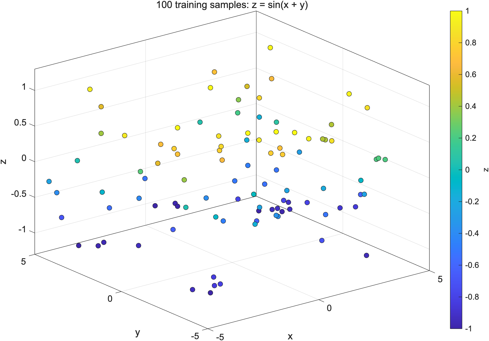
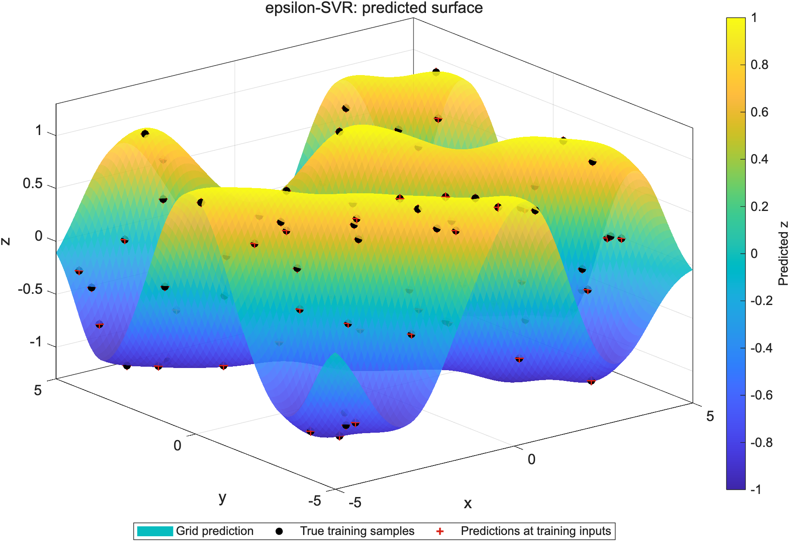
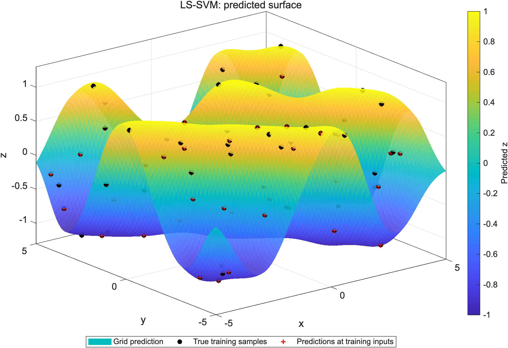

---
header-includes:
  - \usepackage{float}
  - \floatplacement{figure}{H}
---

# CS5486 Assignment 2

## Experiment and models

Using `rng(5486,'twister')`, I generated `X=-5+10*rand(100,2)` and `z=sin(X(:,1)+X(:,2))`. Both models used the same 100 noiseless samples. The two input coordinates were kept unchanged, with no standardization or reduction to one input.

The fixed Gaussian kernel was

$$K(u,v)=\exp\!\left(-\frac{\|u-v\|^2}{2\sigma^2}\right),\qquad \sigma=1.$$

MATLAB's [Gaussian kernel](https://www.mathworks.com/help/stats/fitrsvm.html) divides inputs by `KernelScale`, then uses $\exp(-D^2)$. Thus `KernelScale=sqrt(2)` gives the required kernel. In the downloaded [LS-SVMlab 1.8](https://www.esat.kuleuven.be/stadius/lssvmlab/toolbox.html), both training and prediction call `kernel_matrix.m`, which uses $\exp[-D^2/(2\,\mathrm{sig2})]$, so I used `sig2=1`. The unused standalone `RBF_kernel.m` instead uses $\exp(-D^2/\mathrm{sig2})$; its parameter must not be substituted into this call path. These are parameter conversions; $\sigma$ stays 1. At unit distance, both actual model conventions give 0.606530659713, equal to $e^{-1/2}$.

For $f(u)=w^T\phi(u)+b$, epsilon-SVR solves

$$\min_{w,b,\xi,\xi^*}\;\frac12\|w\|^2+C\sum_i(\xi_i+\xi_i^*),$$

subject to $z_i-f(X_i)\leq\epsilon+\xi_i$, $f(X_i)-z_i\leq\epsilon+\xi_i^*$, and $\xi_i,\xi_i^*\geq0$. I used `fitrsvm` with the SMO solver.

LS-SVM minimizes $\frac12\|w\|^2+\frac{\gamma}{2}\sum_i e_i^2$ subject to $z_i=f(X_i)+e_i$. Its 101-by-101 system is

$$\begin{bmatrix}0&\mathbf1^T\\\mathbf1&K+I/\gamma\end{bmatrix}\begin{bmatrix}b\\\alpha\end{bmatrix}=\begin{bmatrix}0\\z\end{bmatrix},\qquad f(u)=\sum_i\alpha_iK(u,X_i)+b.$$

I used the official `trainlssvm` and `simlssvm`, with `'original'` preprocessing throughout. The installed code calls `lssvmMATLAB`: two MATLAB backslash solves with $H=K+I/\gamma$, followed by elimination of the bias. No MEX solver was used.

## Parameter selection

A single random, balanced five-fold split (20 validation samples per fold) was shared by both models. Selection minimized pooled out-of-fold MSE. Initial candidates were $C=\{1,10,100,1000\}$, $\epsilon=\{0.001,0.01,0.05,0.1\}$ and $\gamma=\{1,10,100,1000,10000\}$. Kernel width was never tuned.

The initial winners were $C=100$, $\epsilon=0.001$ (MSE 0.038576) and $\gamma=10000$ (MSE 0.038575). A predeclared rule added one decade beyond each winning boundary, once. Final candidate sets were `C=[1 10 100 1000]`, `epsilon=[0.0001 0.001 0.01 0.05 0.1]`, `gamma=[1 10 100 1000 10000 100000]`. Any remaining boundary optimum is only the best tested value; the search was not continued indefinitely. All fold scores are saved in `../data/results.mat`.

| Model | Selected parameters | Five-fold MSE |
|:--|:--|--:|
| epsilon-SVR | $C=100$, $\epsilon=0.0001$ | 0.037405 |
| LS-SVM | $\gamma=100000$ | 0.037464 |

Both selected models were refitted on all 100 samples. Only then was a 101-by-101 `meshgrid` from `linspace(-5,5,101)` evaluated. Its 10,201 true targets were used only for final error measurement.

\clearpage

## 3D results

{width=76%}

{width=76%}

\clearpage

{width=76%}

## Accuracy and speed

RMSE and MAE were calculated separately on the 100 training samples and the full evaluation grid. No percentage error was used because the sine target crosses zero.

| Metric | epsilon-SVR | LS-SVM |
|:--|--:|--:|
| Training RMSE | 0.000099 | 0.000106 |
| Training MAE | 0.000099 | 0.000057 |
| Grid RMSE | 0.134672 | 0.136610 |
| Grid MAE | 0.070355 | 0.071900 |
| Grid maximum absolute error | 0.716636 | 0.717608 |

| Time (ms) | epsilon-SVR median (IQR) | LS-SVM median (IQR) |
|:--|--:|--:|
| Retrain on 100 samples | 89.7528 (0.5615) | 6.4052 (0.6009) |
| Predict 10,201 grid points | 0.9061 (0.1272) | 4.5744 (0.4447) |

epsilon-SVR had the lower grid RMSE in this experiment. Training error alone is insufficient: the grid also contains regions between widely spaced samples, including the domain edges.

\clearpage

After five warm-up training and prediction calls per model, I measured 40 fresh fits and 40 grid predictions per model, alternating the order on successive repetitions. Training included initialization, kernel calculation and solving; no Gram matrix was reused. Prediction included its required kernel calculation. Tuning, plots, downloads and file writes were outside the timers. IQR means the 75th percentile minus the 25th percentile. Raw times and measurement order are in `../data/results.mat`.

LS-SVM trained 14.01 times faster by median time; epsilon-SVR predicted 5.05 times faster. SVR retained 98 support vectors; LS-SVM had 100 coefficients with $|\alpha_i|>10^{-10}$ (minimum absolute value 0.0244, maximum 49.1). LS-SVM avoids iterative constrained optimization by solving a small dense linear system. Prediction cost also depends on the implementation: `simlssvm` evaluates all training centers in blocks, while MATLAB uses its SVR prediction backend. The coefficient counts alone do not determine the measured speed. These results apply to this 100-sample experiment, hardware and solver settings.

**Environment:** MATLAB R2026b; Statistics and Machine Learning Toolbox 26.2; LS-SVMlab 1.8; macOS 26.6.2, Apple M3 Pro, 18 GiB RAM.
